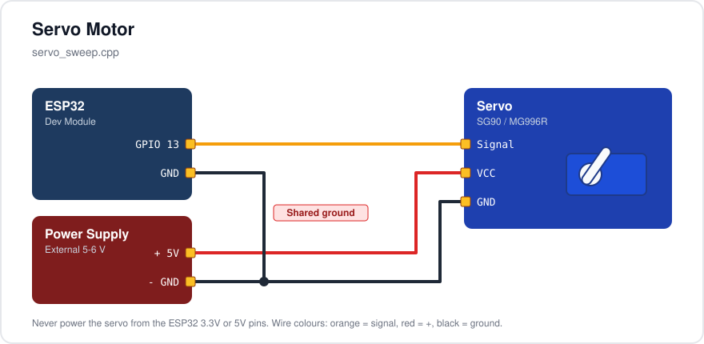
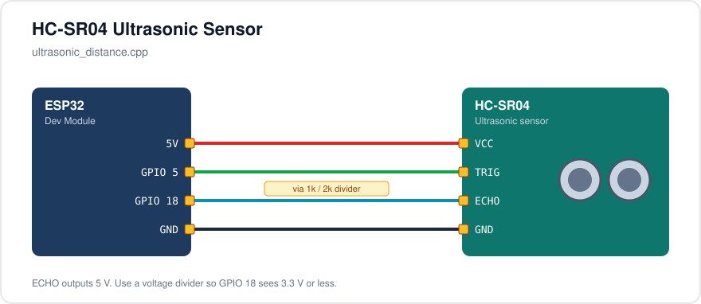
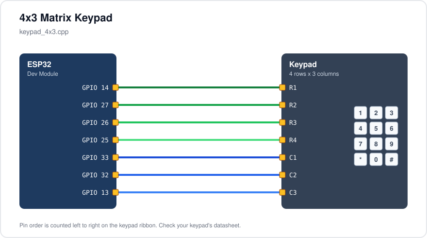
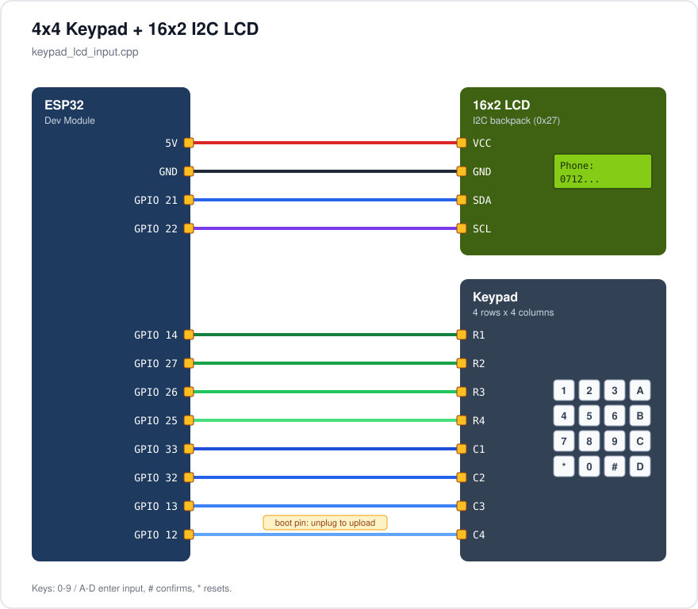
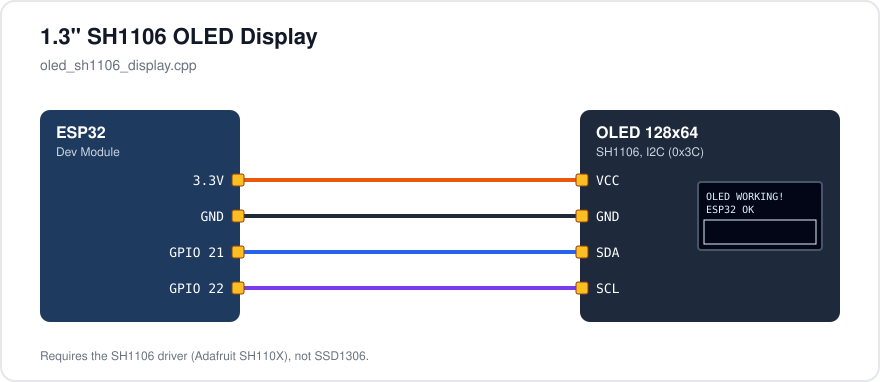

# ESP32 Hardware Toolkit

A collection of small, self-contained Arduino sketches for the **ESP32 Dev Module**, each demonstrating how to wire and drive a common peripheral: a servo motor, an ultrasonic distance sensor, a matrix keypad, a 16x2 I2C LCD, and a 1.3" SH1106 OLED display.

Each sketch is independent. Use them as a reference when wiring a module for the first time, or as a starting point for larger projects.

---

## Table of Contents

- [Examples](#examples)
- [Requirements](#requirements)
- [Getting Started](#getting-started)
- [Wiring](#wiring)
  - [Servo Motor](#1-servo-motor-servo_sweepcpp)
  - [HC-SR04 Ultrasonic Sensor](#2-hc-sr04-ultrasonic-sensor-ultrasonic_distancecpp)
  - [4x3 Matrix Keypad](#3-4x3-matrix-keypad-keypad_4x3cpp)
  - [4x4 Keypad + 16x2 I2C LCD](#4-4x4-keypad--16x2-i2c-lcd-keypad_lcd_inputcpp)
  - [1.3" SH1106 OLED](#5-13-sh1106-oled-oled_sh1106_displaycpp)
- [Troubleshooting](#troubleshooting)
- [ESP32 Pin Notes](#esp32-pin-notes)

---

## Examples

| Sketch | Peripheral | What it does |
|--------|------------|--------------|
| [servo_sweep.cpp](servo_sweep.cpp) | SG90 / MG996R servo | Sweeps the servo from 0° to 180° and back continuously |
| [ultrasonic_distance.cpp](ultrasonic_distance.cpp) | HC-SR04 ultrasonic sensor | Prints the measured distance in cm to the Serial Monitor every 500 ms |
| [keypad_4x3.cpp](keypad_4x3.cpp) | 4x3 membrane keypad | Prints each key press to the Serial Monitor |
| [keypad_lcd_input.cpp](keypad_lcd_input.cpp) | 4x4 keypad + 16x2 I2C LCD | Two-step input form: enter a phone number, then an amount, and confirm |
| [oled_sh1106_display.cpp](oled_sh1106_display.cpp) | 1.3" 128x64 OLED (SH1106) | Displays a test message and frame to verify the display works |

---

## Requirements

### Hardware

<p align="center">
  
</p>
<p align="center"><sub>Photo: <a href="https://commons.wikimedia.org/wiki/File:ESP32_Dev_Board.jpg">ESP32 Dev Board</a> by Edwiyanto, Wikimedia Commons, CC BY-SA 4.0.</sub></p>

Any standard ESP32 DevKit (30 or 38 pin) works with these examples.

- ESP32 development board (ESP32 Dev Module / DevKit V1)
- USB data cable
- Breadboard and jumper wires
- The peripheral(s) for the example you want to run
- **External 5-6 V power supply** for the servo example

### Software

- [Arduino IDE](https://www.arduino.cc/en/software) 2.x (or 1.8.x)
- ESP32 board package by Espressif Systems

### Libraries

Install from the Arduino IDE Library Manager (**Sketch → Include Library → Manage Libraries**):

| Library | Author | Used by |
|---------|--------|---------|
| ESP32Servo | Kevin Harrington | `servo_sweep.cpp` |
| Keypad | Mark Stanley, Alexander Brevig | `keypad_4x3.cpp`, `keypad_lcd_input.cpp` |
| LiquidCrystal I2C | Frank de Brabander | `keypad_lcd_input.cpp` |
| Adafruit GFX Library | Adafruit | `oled_sh1106_display.cpp` |
| Adafruit SH110X | Adafruit | `oled_sh1106_display.cpp` |

`Wire` (I2C) ships with the ESP32 core and needs no separate install. The ultrasonic sensor example uses no external libraries.

---

## Getting Started

### 1. Install the ESP32 board package

1. Open **File → Preferences**.
2. In **Additional Board Manager URLs**, add:
   ```
   https://raw.githubusercontent.com/espressif/arduino-esp32/gh-pages/package_esp32_index.json
   ```
3. Open **Tools → Board → Boards Manager**, search for **ESP32**, and install **esp32 by Espressif Systems**.

### 2. Clone the repository

```bash
git clone https://github.com/BKerio/esp32turnservomotor.git
cd esp32turnservomotor
```

### 3. Open a sketch

The Arduino IDE expects each sketch to be a `.ino` file inside a folder with the same name. To run an example:

1. Create a folder, for example `servo_sweep/`.
2. Copy the contents of the `.cpp` file into `servo_sweep/servo_sweep.ino`.
3. Open `servo_sweep.ino` in the Arduino IDE.

### 4. Configure and upload

| Setting | Value |
|---------|-------|
| Board | ESP32 Dev Module |
| Port | Your ESP32's port (e.g. `COM4` on Windows, `/dev/ttyUSB0` on Linux) |
| Upload Speed | 921600 (use 115200 if uploads are unreliable) |

Click **Upload**, then open the **Serial Monitor** at **115200 baud**.

> **Tip:** If the upload stalls at `Connecting....`, hold the **BOOT** button on the ESP32 until the upload starts, then release it.

---

## Wiring

### 1. Servo Motor (`servo_sweep.cpp`)

<p align="center">
  
</p>
<p align="center"><sub>Photo: <a href="https://commons.wikimedia.org/wiki/File:Tower_Pro_SG90_micro_servo_motor.jpg">Tower Pro SG90 micro servo motor</a> by Suyash Dwivedi, Wikimedia Commons, CC BY-SA 4.0.</sub></p>

<p align="center">
  
</p>

| Servo Wire | Connect To |
|------------|------------|
| Signal (orange/yellow) | ESP32 GPIO 13 |
| VCC (red) | External 5-6 V supply (+) |
| GND (brown/black) | External supply (−) **and** ESP32 GND |

> [!CAUTION]
> Power the servo from an **external supply**, not from the ESP32's 3.3 V or 5 V pins. Servos draw current spikes that can brown out or reset the board.
>
> The external supply's ground **must** be connected to the ESP32 GND. Without a shared ground, the control signal has no reference and the servo will not respond reliably.

The servo is driven at 50 Hz with a 500-2400 µs pulse range. Adjust `PULSE_MIN_US` and `PULSE_MAX_US` in the sketch if your servo does not reach its full travel.

### 2. HC-SR04 Ultrasonic Sensor (`ultrasonic_distance.cpp`)

<p align="center">
  
</p>
<p align="center"><sub>Photo: <a href="https://commons.wikimedia.org/wiki/File:HC_SR04_Ultrasonic_Module.jpg">HC SR04 Ultrasonic Module</a> by Suyash Dwivedi, Wikimedia Commons, CC BY-SA 4.0.</sub></p>

<p align="center">
  
</p>

| HC-SR04 Pin | ESP32 Pin |
|-------------|-----------|
| VCC | 5V (VIN) |
| GND | GND |
| TRIG | GPIO 5 |
| ECHO | GPIO 18 |

> [!WARNING]
> The HC-SR04 ECHO pin outputs 5 V, but ESP32 GPIOs are 3.3 V tolerant only. Use a voltage divider (e.g. 1 kΩ + 2 kΩ) on the ECHO line, or a 3.3 V compatible sensor such as the HC-SR04P.

A reading of `0.00 cm` means no echo was received within the 30 ms timeout (object out of range, or a wiring fault).

### 3. 4x3 Matrix Keypad (`keypad_4x3.cpp`)

<p align="center">
  
</p>
<p align="center"><sub>Photo: <a href="https://commons.wikimedia.org/wiki/File:Keypad_arduino.jpg">Keypad arduino</a> by Goga504, Wikimedia Commons, CC BY-SA 4.0. Shown: the 4x4 version used in example 4. The 4x3 version is the same without the A-D column.</sub></p>

<p align="center">
  
</p>

| Keypad Pin | ESP32 GPIO |
|------------|------------|
| R1 | 14 |
| R2 | 27 |
| R3 | 26 |
| R4 | 25 |
| C1 | 33 |
| C2 | 32 |
| C3 | 13 |

### 4. 4x4 Keypad + 16x2 I2C LCD (`keypad_lcd_input.cpp`)

<p align="center">
  
</p>
<p align="center"><sub>Photo: <a href="https://commons.wikimedia.org/wiki/File:Mizar32_I2C_LCD_module_16x2.jpg">Mizar32 I2C LCD module 16x2</a> by Martinwguy, Wikimedia Commons, CC BY-SA 3.0.</sub></p>

<p align="center">
  
</p>

**LCD (I2C backpack)**

| LCD Pin | ESP32 Pin |
|---------|-----------|
| VCC | 5V |
| GND | GND |
| SDA | GPIO 21 |
| SCL | GPIO 22 |

**Keypad**

| Keypad Pin | ESP32 GPIO |
|------------|------------|
| R1 | 14 |
| R2 | 27 |
| R3 | 26 |
| R4 | 25 |
| C1 | 33 |
| C2 | 32 |
| C3 | 13 |
| C4 | 12 |

**Controls**

| Key | Action |
|-----|--------|
| `0`-`9`, `A`-`D` | Append a character to the current field |
| `#` | Confirm the phone number and move to amount, then confirm the amount |
| `*` | Clear everything and start over |

The LCD I2C address is set to `0x27`. If the screen lights up but shows no text, change it to `0x3F` and adjust the contrast potentiometer on the back of the module.

### 5. 1.3" SH1106 OLED (`oled_sh1106_display.cpp`)

<p align="center">
  
</p>
<p align="center"><sub>Photo: <a href="https://commons.wikimedia.org/wiki/File:ESP32_SH1106_Power-Meter_01.jpg">ESP32 SH1106 Power-Meter 01</a> by King of Pwnt, Wikimedia Commons, CC0.</sub></p>

<p align="center">
  
</p>

| OLED Pin | ESP32 Pin |
|----------|-----------|
| VCC | 3.3V |
| GND | GND |
| SDA | GPIO 21 |
| SCL | GPIO 22 |

Most 1.3" 128x64 modules (such as the JMD 1.3A) use the **SH1106** controller, not the SSD1306. That is why this sketch uses the Adafruit SH110X library. The default I2C address is `0x3C`; some modules use `0x3D`.

---

## Troubleshooting

| Symptom | Likely Cause | Fix |
|---------|--------------|-----|
| Upload fails at `Connecting....` | Board not in bootloader mode | Hold **BOOT** while uploading |
| No COM port appears | Charge-only USB cable or missing driver | Use a data cable; install the CP210x or CH340 driver |
| Serial Monitor shows garbled text | Wrong baud rate | Set the Serial Monitor to **115200** |
| Servo jitters or ESP32 resets | Servo powered from the ESP32 | Use an external supply with a shared ground |
| LCD/OLED blank | Wrong I2C address or SDA/SCL swapped | Run an I2C scanner sketch and check wiring |
| OLED shows noise or a shifted image | Wrong driver | Use the SH1106 driver (Adafruit SH110X), not SSD1306 |
| Upload fails with keypad connected | GPIO 12 pulled high at boot | Disconnect keypad column C4 while uploading |

---

## ESP32 Pin Notes

- **Generally safe for I/O:** 13, 14, 16-19, 21-23, 25-27, 32, 33
- **Avoid:** 6-11 (connected to on-board flash), 1 and 3 (USB serial TX/RX)
- **Use with care (boot strapping pins):** 0, 2, 5, 12, 15. These affect boot mode if pulled high or low at power-up.
- **Input only:** 34, 35, 36, 39 (no internal pull-ups, cannot drive outputs)
- **Default I2C:** SDA = GPIO 21, SCL = GPIO 22
